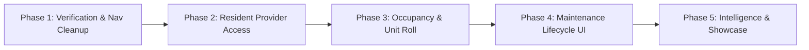

# VALORA Frontend Reconnaissance & Integration Architecture Plan

> **Executive Update (Oct 22, 2026)**  
> This recon reflects the latest production changes on `VANTAGE` (`main` and `codex/valora-handoff` at commit `b7d5a75`, migration `d14a5b9e7f23`).  
> **Crucial Scope Refocus**: VANTAGE has officially focused its scope on **Property & Complex Management** (residents, maintenance/repairs, building health via Living Score, notifications, and estate operations). The investor, estate agent, valuation/ROI calculator, and marketplace listing APIs and UI have been **retired** from active product scope (their backend routes return 404).  
> Consequently, our integration strategy prioritizes adapting Group8Project's strong resident, occupancy, maintenance, provider, and operational UI workflows into VANTAGE's functional backend and design system.

---

## 1. High-Level System Comparison

| Dimension | Group8Project Frontend (`c:\Users\garah\PycharmProjects\Group8Project\Group8Project-main\FrontEnd`) | VANTAGE Functional Frontend (`C:\Users\garah\PycharmProjects\VANTAGE\frontend`) | Integration Target Strategy |
| :--- | :--- | :--- | :--- |
| **Product Scope** | Broad, disparate prototype covering investor ROI, agent listings, property sales/rentals, alongside resident complaints and directory. | **Laser-focused on residential property & building management**: resident onboarding, unit directory, maintenance lifecycle, work orders, Living Score, and building operations. | **Align to VANTAGE Management Scope**: Retire investor and agent marketing flows. Elevate resident, unit, maintenance, provider, and admin features. |
| **Build & Tooling** | React 19, React Router 7, custom `esbuild` scripts (`scripts/dev-server.mjs`, `scripts/build.mjs`). | React 19, Vite 7, Tailwind CSS v4, Radix UI Primitives, Lucide React, Recharts, Vitest. (Migrated from TypeScript to clean JavaScript/JSX). | **Adopt VANTAGE stack** (Vite 7 + Tailwind v4 + Radix + Lucide + Vitest). |
| **Design System & Styling** | Per-component `.css` stylesheets; variable class naming; raw HTML modals and `window.alert()` / `confirm()` prompts. | Cohesive design system in `src/components/valora/` & `src/components/ui/` (`Surface`, `AppShell`, `DataTable`, `Drawer`, `StatusChip`, `ScoreCard`, `SignalField`). Soft lavender & deep ink palette. | **Migrate all UI elements to VANTAGE design tokens and primitives**. Replace raw CSS and browser dialogs with Radix dialogs/drawers and Tailwind v4. |
| **Authentication & Identity** | Client-side mock fallback (`localStorage.getItem("valoraUser")` / `"valoraUsers"`), role selection dropdown on public register. | Strict JWT Bearer token authentication (`AuthContext`, `/api/v1/auth/login`, `/api/v1/auth/me`). **Public registration restricted to residents only**; manager/provider accounts provisioned by operators (`/api/v1/auth/provision`). Single-use token password recovery. | **Use VANTAGE JWT & AuthContext**. Eliminate all `localStorage` mock credentials. Direct public signup exclusively to resident accounts. |
| **Tenancy & Multi-Estate Boundary** | Global single-tenant assumptions; records lack cryptographic tenancy boundaries. | Strict Estate Scoping via `EstateContext` & `useEstateScope()`; every API request sends `?estate_id=...`; backend enforces `EstateAuthorizationService.resolve_access`. | **Enforce Estate Scoping across all migrated views**. Every query and mutation is bound to the active `estate_id`. |
| **Business Logic & Calculations** | Client-side math in React (`ROI.jsx`, `Valuation.jsx`, Living score math in local storage). | Zero business logic in React; server-side deterministic calculation endpoints (`/api/v1/analytics/living-score`). Retired client math entirely. | **Preserve VANTAGE's strict rule**: all calculations belong in the backend. Group8 UI inputs pipe directly into verified endpoints. |
| **Data Persistence** | Browser `localStorage` for properties, complaints, requests, directory, inquiry logs. | PostgreSQL database via async SQLAlchemy & FastAPI REST endpoints with Alembic migrations (`d14a5b9e7f23`). | **Replace all `localStorage` mock stores with real FastAPI endpoints and typed DTOs**. |

---

## 2. Directory & Component Inventory: "What Exists Where"

### 2.1 Group8Project Frontend Inventory (`Group8Project-main/FrontEnd/app`)

```
Group8Project-main/FrontEnd/app/
├── App.jsx                                # Monolithic router defining ~35 flat routes & localStorage auth guards
├── index.html / main.jsx                  # Application entry points
├── assets/                                # Logo SVGs (ValoraLogo.jpeg, valora-logo.svg)
├── components/                            # ConfirmPrompt.jsx, ErrorBoundary.jsx, InlineMessage.jsx
├── data/                                  # LocalStorage data stores (inquiryStorage, landingPageStorage,
│                                          # properties, propertyRequests, propertyStorage)
├── services/                              # Attempted API services (apiClient, authService, complaintApi,
│                                          # propertyApi, providerApi, workOrderApi, etc.)
└── pages/
    ├── Home.jsx                           # Public landing page with hero, features, properties preview
    ├── Dashboard.jsx                      # Dispatches to role-specific dashboard based on user.role
    ├── Profile.jsx                        # User profile view and update
    ├── RequestToSell.jsx                  # [RETIRED SCOPE] Resident request to sell or rent unit
    ├── Complaints.jsx                     # Resident complaints submission & list
    ├── AI/
    │   └── AITrainingData.jsx             # HOA Admin screen to configure & review datasets
    ├── Announcements/
    │   ├── Announcements.jsx              # Resident view of community announcements
    │   └── CommunityAnnouncements.jsx     # HOA Admin CRUD for announcements
    ├── Auth/
    │   ├── Login.jsx                      # Email/password login
    │   ├── Register.jsx                   # Public registration with role selection
    │   └── RegistrationPending.jsx        # Holding screen for pending approvals
    ├── Community/
    │   ├── Providers.jsx                  # Public/Resident & Admin Service Provider Directory
    │   └── CommunityAnalytics.jsx         # HOA Admin metrics for residents, units, complaints
    ├── Complaints/
    │   └── ResidentComplaints.jsx         # HOA Admin management of all submitted complaints
    ├── Dashboards/
    │   ├── shared/DashboardSidebar.jsx    # Custom navigation rail with role-filtered links & SVG icons
    │   ├── Resident/ResidentDashboard.jsx # Resident dashboard (unit card, quick actions, issues)
    │   ├── Investor/InvestorDashboard.jsx # [RETIRED SCOPE] Investor portfolio & yield shortcuts
    │   ├── EstateAgent/EstateAgentDashboard.jsx # [RETIRED SCOPE] Agent listings & inquiries
    │   ├── HOAAdmin/HOAAdminDashboard.jsx # HOA Admin operational dashboard
    │   ├── HOAAdmin/LandingPageSettings.jsx # CMS for public website copy & hero banner upload
    │   └── HeadAdmin/HeadAdminDashboard.jsx # System administrator control panel
    ├── EstateAgent/
    │   ├── AgentListings.jsx              # [RETIRED SCOPE] Assigned properties table
    │   ├── AgentEditListings.jsx          # [RETIRED SCOPE] Form to create/edit asking prices & photos
    │   └── AgentInquiries.jsx             # [RETIRED SCOPE] Log of buyer/investor inquiries
    ├── HeadAdmin/
    │   ├── RegistrationRequests.jsx       # Approving/rejecting pending accounts
    │   └── UserManagement.jsx             # System-wide user list, role summary & access revocation
    ├── Investor/
    │   ├── Valuation.jsx                  # [RETIRED SCOPE] Property valuation calculator
    │   └── ROI.jsx                        # [RETIRED SCOPE] 10-year ROI and rental yield calculator
    ├── Maintenance/
    │   └── Maintenance.jsx                # Maintenance request submission & tracking
    ├── Property/
    │   ├── Properties.jsx                 # Public / catalog property browsing grid
    │   ├── Property.jsx                   # Public individual property detail view
    │   ├── MyProperty.jsx                 # Resident view of their owned/occupied unit
    │   ├── PropertyRequests.jsx           # [RETIRED SCOPE] HOA Admin review of sell/rent requests
    │   ├── PropertyApprovals.jsx          # [RETIRED SCOPE] HOA Admin review of agent listing drafts
    │   └── PropertyManagement.jsx         # Head Admin property register creation & editing
    └── Resident/
        └── ResidentDirectory.jsx          # HOA Admin unit-to-resident assignment & occupancy tracking
```

---

### 2.2 VANTAGE Frontend Inventory (`VANTAGE/frontend/src` at commit `b7d5a75`)

```
VANTAGE/frontend/src/
├── App.jsx                                # Routes with AuthProvider, EstateProvider, role redirection & legacy aliases
├── main.jsx / index.css                   # Vite entry point, Tailwind CSS v4 setup & typography tokens
├── api/
│   └── generated/enums.js                 # Backend OpenAPI mirrored enums (trades, complaint priorities, etc.)
├── context/
│   ├── AuthContext.jsx                    # Real JWT auth, session restore, login, registration, logout
│   └── EstateContext.jsx                  # Selected estate scope, living score, estate capabilities
├── lib/
│   ├── api.js                             # Authenticated fetch client (JWT Bearer, ?estate_id scoping, ApiError)
│   ├── estateAdmin.js                     # Photo upload chunking, bulk unit parsing, join code rotation
│   ├── accountSupport.js                  # Operational account support, unit edits, transfers, move-out API calls
│   ├── analytics.js                       # Living Score snapshots, 24-month history, recalculate trigger
│   ├── format.js                          # Formatting for ZAR currency, dates, percentages, names
│   ├── nav.js                             # Dynamic navigation groups per role with Lucide icons
│   └── roleRouting.js                     # Canonical first landing page per role
├── components/
│   ├── AppShell.jsx                       # Responsive workspace shell (Sidebar + TopBar + MobileNav)
│   ├── Brand.jsx / Icons.jsx              # Unified branding and icon library
│   ├── ComplaintDrawer.jsx                # Lifecycle complaint view, evidence log, provider assign, rating & reopen
│   ├── RequireEstate.jsx                  # Guard ensuring an estate is selected before rendering
│   ├── layout/                            # Sidebar.jsx, TopBar.jsx, EstateSwitcher.jsx, MobileNav.jsx
│   ├── ui/                                # Button, Card, Chip, Drawer, EmptyState, ErrorState, Input,
│   │                                      # LoadingState, Select, TableShell, Textarea
│   └── valora/                            # AskValora, CreateWorkOrderDialog, DataTable, HealthPillars,
│                                          # LivingScore, RecommendationCard, ScoreCard, SignalField, Surface
└── routes/
    ├── Landing.jsx                        # Public landing page (focused on complex living & building health)
    ├── Contact.jsx                        # Public inquiry / contact page
    ├── Login.jsx                          # Real FastAPI-connected authentication
    ├── Register.jsx                       # Resident-only signup with link to operator provisioning info
    ├── PasswordRecovery.jsx               # Single-use token password reset request & confirmation
    ├── Join.jsx / RequestAccess.jsx / Welcome.jsx # Resident onboarding & join code / approval flows
    ├── Dashboard.jsx                      # Authorized operational overview (real counts, Living Score, overdue work)
    ├── EstateHealth.jsx                   # Deep Living Score drill-down, 5 pillars, historical Recharts AreaChart
    ├── Complaints.jsx                     # Complaint table with server filters & LogComplaintDrawer
    ├── WorkOrders.jsx                     # Work order tracking, cost, SLA, assignment
    ├── Incidents.jsx                      # Security and safety incidents register
    ├── Announcements.jsx                  # Estate notices & community broadcasts
    ├── Properties.jsx                     # Real estate-scoped unit roll with unit editing drawer (PATCH /properties/{id})
    ├── Intelligence.jsx                   # Weekly AI briefing, AskValora chat, recommendations, and briefing history selector
    ├── Providers.jsx                      # HOA Admin verified provider directory with trade/ratings filters
    ├── ProviderWork.jsx                   # Service provider jobs, photo evidence, job completion
    ├── ProviderWaiting.jsx                # Holding view for unassigned or pending providers
    ├── AdminSetup.jsx                     # Estate profile, 12-photo gallery, bulk unit CSV/text import, join codes
    ├── AdminResidency.jsx                 # Resident registration requests approval/rejection drawer
    ├── Members.jsx                        # Estate memberships register with unit transfer & move-out deletion
    ├── Notifications.jsx                  # In-app notification inbox, unread pills, mark as read & preference settings
    └── Settings.jsx                       # Operational links and account notification preferences
```

---

## 3. Side-by-Side Detailed Recon & Mapping

```mermaid
flowchart TD
    subgraph G8["Group8Project (Team Frontend)"]
        G8_Auth["Auth: localStorage Mock"]
        G8_Dash["5 Separate Dashboard Files"]
        G8_Comp["Complaints + ResidentComplaints + Maintenance"]
        G8_Dir["ResidentDirectory (Holder Linking)"]
        G8_Prov["Providers (Resident + Admin)"]
        G8_Ann["Announcements + CommunityAnnouncements"]
        G8_AI["AITrainingData (Signal counts)"]
        G8_Settings["LandingPageSettings (CMS)"]
        G8_Retired["RequestToSell + AgentListings + Inquiries + Valuation + ROI"]
    end

    subgraph VANTAGE["VANTAGE Production Architecture"]
        V_Auth["JWT Bearer + AuthContext + PasswordRecovery"]
        V_Shell["Unified AppShell + Adaptive Dashboard"]
        V_Comp["Complaints.jsx + ComplaintDrawer (Reopen + Rating)"]
        V_Dir["Members.jsx (Unit Transfer + Move-Out) + Properties.jsx"]
        V_Prov["Providers.jsx + ProviderWork.jsx"]
        V_Ann["Announcements.jsx"]
        V_AI["Intelligence.jsx (History + Grounded Priorities)"]
        V_Setup["AdminSetup.jsx (Photo gallery + Estate profile)"]
        V_Notif["Notifications.jsx (In-app inbox & preferences)"]
        V_Retired["RETIRED SCOPE: Returns 404 on backend"]
    end

    G8_Auth -->|Elevate to JWT & Recovery| V_Auth
    G8_Dash -->|Unify into single shell| V_Shell
    G8_Comp -->|Wire to full lifecycle & reopen| V_Comp
    G8_Dir -->|Wire to PATCH /unit & DELETE /memberships| V_Dir
    G8_Prov -->|Add resident read & click-to-call| V_Prov
    G8_Ann -->|Connect to notices API| V_Ann
    G8_AI -->|Connect to briefing history & signal sources| V_AI
    G8_Settings -->|Incorporate showcase fields| V_Setup
    G8_Retired -.->|Do NOT migrate: Out of Scope| V_Retired
```



### 3.1 Mapping Table: Group8 vs. VANTAGE

| Feature / Screen | Group8 Implementation | VANTAGE Implementation | Architectural Status & Action |
| :--- | :--- | :--- | :--- |
| **Authentication** | `Auth/Login.jsx`, `Register.jsx`, `localStorage` mock users | `routes/Login.jsx`, `Register.jsx`, `AuthContext.jsx` | **Adopt VANTAGE**. Real JWT, resident-only signup, operator provisioning for managers/providers. |
| **Password Recovery** | None (simulated login) | `routes/PasswordRecovery.jsx`, `lib/accountSupport.js` | **VANTAGE already built**. Single-use expiring token via SMTP. |
| **Navigation & Shell** | `DashboardSidebar.jsx` with hardcoded role arrays | `components/AppShell.jsx`, `lib/nav.js` | **Adopt VANTAGE**. Responsive sidebar, topbar, mobile bottom nav. |
| **Dashboard** | 5 files (`ResidentDashboard`, `InvestorDashboard`, `HOAAdminDashboard`, etc.) | Single adaptive `routes/Dashboard.jsx` | **Adopt VANTAGE**. Adapts to authorized role; displays real counts and Living Score. |
| **Resident Directory & Occupancy** | `ResidentDirectory.jsx` (`localStorage` holder assignments) | `routes/Members.jsx` & `routes/Properties.jsx` | **INTEGRATE & ELEVATE**: Connect Group8's unit holder UI to VANTAGE's `PATCH /memberships/{id}/unit` (transfer), `PATCH /properties/{id}` (edit unit), and `DELETE /memberships/{id}` (move-out). |
| **Complaints & Repairs** | `Complaints.jsx`, `ResidentComplaints.jsx`, `Maintenance.jsx` | `routes/Complaints.jsx`, `routes/WorkOrders.jsx`, `ComplaintDrawer.jsx` | **INTEGRATE & ELEVATE**: Enhance VANTAGE's `ComplaintDrawer` with Group8's clean issue reporting UI, utilizing VANTAGE's repeat-repair reopening (`POST /complaints/{id}/reopen`) and resident rating (`POST /work-orders/{id}/rating`). |
| **Service Providers** | `Community/Providers.jsx` (resident browse + click-to-call, admin CRUD) | `routes/Providers.jsx`, `routes/ProviderWork.jsx` | **INTEGRATE & ELEVATE**: VANTAGE `Providers.jsx` is HOA-only; update to give residents read-only access with trade filters and `tel:...` click-to-call buttons. |
| **Announcements** | `Announcements.jsx` & `CommunityAnnouncements.jsx` | `routes/Announcements.jsx` | **Adopt VANTAGE**. Scoped community notices with estate authorization. |
| **In-App Notifications** | None | `routes/Notifications.jsx` | **VANTAGE already built**. Recipient-scoped maintenance notifications, read receipts, and preference toggle. |
| **Building Health & AI** | `AITrainingData.jsx` (mock review counts) | `routes/EstateHealth.jsx` & `routes/Intelligence.jsx` | **INTEGRATE**: Embed signal verification into `Intelligence.jsx` showing the overdue jobs and unassigned complaints backing the weekly briefing. Connect briefing history selector. |
| **Estate Showcase / Landing** | `LandingPageSettings.jsx` (banner photo upload & copy) | `routes/AdminSetup.jsx` & `routes/Landing.jsx` | **INTEGRATE**: Let HOA admin configure estate showcase highlights in `AdminSetup.jsx` (using existing chunked photo upload). |
| **Investor & Market Flows** | `Valuation.jsx`, `ROI.jsx`, `AgentListings.jsx`, `AgentInquiries.jsx`, `RequestToSell.jsx`, `PropertyApprovals.jsx` | **Retired from active scope** (`HANDOFF_BACKEND.md`) | **DO NOT MIGRATE**. Backend endpoints return 404; scope is strictly property management. |

---

## 4. Architectural Guardrails for the Integration

1. **Strict Estate Tenancy**:
   - Every API request must pass the selected `?estate_id=...` parameter via `useEstateScope()`.
   - Never query or render data across estates without backend authorization resolution.
2. **Server-Owned Business Logic**:
   - Zero math or score formulas in React components. All living score calculations, priority derivations, and status transitions occur exclusively on the backend.
3. **Resident-Only Public Registration**:
   - The public signup form creates residents only. Manager and provider accounts must never be exposed as self-registration options; they are operator-provisioned.
4. **VANTAGE Design System Compliance**:
   - Discard all individual `.css` files from Group8Project.
   - Use Tailwind CSS v4 design tokens:
     - Ink: `text-ink`, `text-ink-soft`, `text-ink-muted`
     - Brand: `bg-brand`, `text-brand-ink`, `bg-brand-wash`
     - Semantics: `mint` (healthy), `ochre` (attention/watch), `rose` (risk)
     - Borders: `border-line` (`#E9E3FF`)
   - Use Radix UI primitives for dialogs, drawers, dropdowns, and tabs. Discard `window.alert()` and `window.confirm()`.

---

## 5. High-Value Features: Detailed Integration Blueprint

### 5.1 Feature 1: Resident & Occupancy Directory
*Source in Group8*: `app/pages/Resident/ResidentDirectory.jsx`  
*Target in VANTAGE*: `src/routes/Members.jsx` & `src/routes/Properties.jsx`  
*Concept & Capabilities*:
- Group8 had a table showing each unit, its assigned resident, contact info, and status (`Occupied` vs. `Vacant`).
- VANTAGE recently added three dedicated management endpoints:
  1. `PATCH /api/v1/properties/{unit_id}` (edit address, size, bedrooms, bathrooms)
  2. `PATCH /api/v1/memberships/{membership_id}/unit` with `{property_id}` (transfer resident)
  3. `DELETE /api/v1/memberships/{membership_id}` (move-out / revoke access while retaining history)
- **The Integration**:
  - Enhance VANTAGE's `Members.jsx` and `Properties.jsx` with a unified "Occupancy Roll" tab using VANTAGE's `DataTable`.
  - Provide inline actions: "Edit Unit Details", "Transfer Resident", and "Process Move-Out".
  - Ensure all mutations execute with confirmation dialogs explaining the audit trail.

---

### 5.2 Feature 2: Complete Maintenance & Repair Lifecycle
*Source in Group8*: `app/pages/Complaints.jsx`, `app/pages/Complaints/ResidentComplaints.jsx`, `app/pages/Maintenance/Maintenance.jsx`  
*Target in VANTAGE*: `src/routes/Complaints.jsx`, `src/routes/WorkOrders.jsx`, `src/components/ComplaintDrawer.jsx`  
*Concept & Capabilities*:
- Group8 had clear forms for residents to report maintenance issues (category, description, urgency).
- VANTAGE now has the complete audited repair lifecycle:
  1. Resident reports issue -> `POST /api/v1/complaints`
  2. HOA Admin reviews & assigns contractor -> `POST /api/v1/work-orders`
  3. Contractor accepts, starts & completes job with photo evidence -> `PATCH /api/v1/work-orders/{id}`
  4. Resident rates completed job -> `POST /api/v1/work-orders/{id}/rating` with `{rating: 1..5}`
  5. If issue persists, resident can reopen repair -> `POST /api/v1/complaints/{id}/reopen` with mandatory `{note}`
- **The Integration**:
  - Elevate Group8's resident issue reporting form into VANTAGE's `LogComplaintDrawer`.
  - Ensure residents see their active issues, contractor progress, and the star-rating dialog upon completion.
  - Expose the "Reopen Repair" button inside `ComplaintDrawer` when a job is marked resolved but requires follow-up.

---

### 5.3 Feature 3: Resident Provider Directory & Click-to-Call
*Source in Group8*: `app/pages/Community/Providers.jsx`  
*Target in VANTAGE*: `src/routes/Providers.jsx`  
*Concept & Capabilities*:
- In Group8, residents could browse approved estate contractors by trade and click to call them.
- In VANTAGE, `Providers.jsx` is currently restricted to `hoa_admin` in `lib/nav.js`.
- **The Integration**:
  - Update `lib/nav.js` to allow `resident` access to `/app/providers`.
  - In `Providers.jsx`, detect the user's role:
    - **Residents**: See a read-only contractor directory filtered by trade (plumber, electrician, locksmith), with verified badges and a prominent "Call Provider" button (`tel:...`).
    - **HOA Admins**: Retain full contractor management (invite, approve, assign work orders, update status).

---

### 5.4 Feature 4: Operational Signal Feeds & Briefing History
*Source in Group8*: `app/pages/AI/AITrainingData.jsx`  
*Target in VANTAGE*: `src/routes/Intelligence.jsx`  
*Concept & Capabilities*:
- Group8 had an "AI Training Data" screen that counted complaints and maintenance records.
- VANTAGE has a true intelligence engine (`/api/v1/analytics/intelligence`) that parses operational signals to generate recommendations. It also has briefing history (`/history` and `/history/{id}`).
- **The Integration**:
  - In `Intelligence.jsx`, provide an "Operational Data Health" drawer displaying the raw counts of overdue work orders and unassigned complaints feeding the briefing.
  - Maintain the saved briefing history selector so managers can inspect past weekly reports.

---

### 5.5 Feature 5: Estate Showcase & CMS Controls
*Source in Group8*: `app/pages/Dashboards/HOAAdmin/LandingPageSettings.jsx`  
*Target in VANTAGE*: `src/routes/AdminSetup.jsx` & `src/routes/Landing.jsx`  
*Concept & Capabilities*:
- Group8 allowed HOA admins to update landing page copy and upload hero banners.
- VANTAGE already has chunked photo uploads and estate profile editing in `AdminSetup.jsx`.
- **The Integration**:
  - Add estate highlight cards and showcase banner selection to `AdminSetup.jsx`.
  - Display these verified highlights on `Landing.jsx` and `PublicEstateDetail.jsx`.

---

## 6. Phased Execution Roadmap



### Phase 1: Environment Verification & Navigation Integrity
- [x] Fast-forward local `main` to `origin/main` (commit `b7d5a75`).
- [x] Fix missing `Settings` icon import in `VANTAGE/frontend/src/lib/nav.js`.
- [x] Confirm unit test execution (`Members.test.jsx`, `Properties.test.jsx`, `Register.test.jsx`).
- [ ] Verify that all legacy Group8 URL bookmarks in `App.jsx` redirect cleanly to their corresponding management screens.

### Phase 2: Resident Service Provider Directory
- [ ] Update `VANTAGE/frontend/src/lib/nav.js` to include `resident` role for `/app/providers`.
- [ ] Update `VANTAGE/frontend/src/routes/Providers.jsx`:
  - Show trade-categorized contractor cards for residents with "Call Provider" (`tel:...`) action.
  - Protect contractor creation/editing for `hoa_admin`.

### Phase 3: Occupancy & Unit Directory
- [ ] Enhance `VANTAGE/frontend/src/routes/Properties.jsx` and `Members.jsx`:
  - Incorporate Group8's unit occupancy view (`Occupied` vs. `Vacant` pill, resident name, contact).
  - Verify unit edit drawer (`PATCH /properties/{id}`).
  - Verify resident unit transfer modal (`PATCH /memberships/{id}/unit`).
  - Verify move-out confirmation dialog (`DELETE /memberships/{id}`).

### Phase 4: Maintenance Lifecycle & Issue Reporting
- [ ] Refine `VANTAGE/frontend/src/components/ComplaintDrawer.jsx` and `LogComplaintDrawer`:
  - Incorporate Group8's intuitive category picker and description inputs.
  - Verify "Reopen Repair" action with resident note.
  - Verify resident star-rating modal upon work order completion.

### Phase 5: Intelligence Signals & Estate Showcase
- [ ] Enhance `VANTAGE/frontend/src/routes/Intelligence.jsx` with an operational data health indicator showing the underlying open complaints and overdue work orders.
- [ ] Enhance `VANTAGE/frontend/src/routes/AdminSetup.jsx` with estate showcase highlights.

---

## 7. Immediate Next Steps Checklist

- [x] **Step 1**: Sync VANTAGE `main` and confirm latest commits (`b7d5a75`).
- [x] **Step 2**: Fix `Settings` reference error in `VANTAGE/frontend/src/lib/nav.js`.
- [ ] **Step 3**: Implement Phase 2: Resident Provider Directory & Click-to-Call in `VANTAGE/frontend/src/routes/Providers.jsx`.
- [ ] **Step 4**: Run Vitest and build checks to guarantee zero regressions.
